# Sparkkeep — Self-Hosted Capture & Action Engine

<p align="center">
  <b>Turn fleeting thoughts, links, and media into prioritized, actionable execution cards.</b>
  <br />
  <i>Packaged as a lightning-fast single binary with zero external database dependencies.</i>
</p>

<p align="center">
  <!-- Core Build & Security Status -->
  <a href="https://github.com/BurlacuAndrei/sparkkeep/actions/workflows/ci.yml"></a>
  <a href="https://github.com/BurlacuAndrei/sparkkeep/actions/workflows/docker.yml"></a>
  <a href="https://github.com/BurlacuAndrei/sparkkeep/actions/workflows/scorecard.yml"></a>
  <br />
  <!-- Release & Distribution -->
  <a href="https://github.com/BurlacuAndrei/sparkkeep/releases"></a>
  <a href="https://github.com/BurlacuAndrei/sparkkeep/pkgs/container/sparkkeep"></a>
  <a href="go.mod"></a>
  <a href="LICENSE"></a>
  <br />
  <!-- Community & Support -->
  <a href="https://github.com/BurlacuAndrei/sparkkeep/issues"></a>
  <a href="https://ko-fi.com/andreiburlacu"></a>
  <a href="https://github.com/sponsors/BurlacuAndrei"></a>
</p>

---

## 💡 Why Sparkkeep?

Most "read-it-later" and bookmarking apps are digital graveyards: you save interesting links, repos, and notes, but **never execute on them**. 

**Sparkkeep is not a bookmark manager — it is an Action Engine.**

When you share an idea, tweet, GitHub repository, audio memo, or screenshot from your mobile phone or web browser, Sparkkeep:
1. **Captures it immutably** with full source provenance tracking (or seeds user-authored **Subject Cards** without requiring external URLs).
2. **Filters engagement bait** via an automated Triage Noise Gate so clickbait and spam never pollute your Inbox.
3. **Scrapes & transcribes** content automatically (headless Chrome, yt-dlp, Whisper ASR).
4. **Synthesizes a structured Triage Brief** using your choice of LLM (local Ollama or cloud BYOK) with a consolidated single-card default and 3-card fission cap.
5. **Decomposes complex items** into discrete, actionable cards routed to realistic horizons (**Now**, **Next**, **Later**).
6. **Enables deep, hallucination-free research playbooks** in **Playbook Studio** with factual web groundings and citations.
7. **Drives execution** on a widescreen **Execution Board** with Focus Spotlight, swimlanes, inline action checklists, and a docked inspector.
8. **Closes the loop** with an **Intelligence Digest** retrospective and one-way exports to Obsidian, Notion, and Joplin.

```
 Traditional Bookmarkers:  Save Link ─────────────► Digital Graveyard 💀
 Sparkkeep Engine:         Capture ──► Noise Gate ──► AI Triage ──► Horizon Routing ──► Execution Board ──► Deep Research ──► Digest Review ──► Shipped 🚀
```

---

## 🖥️ Platform Showcase

Every view in Sparkkeep is crafted for keyboard speed, minimal cognitive load, and frictionless execution.

### 1. Execution Board Workspace
A full-width execution canvas replaces the old fixed-width Kanban. **Focus Spotlight** recommends one high-leverage card and its next unchecked step, while **Execution Pulse** shows live action-step progress, Research Ready cards, 7-day shipped velocity, and a quiet Idle (`14d+`) filter for stale work. Cards are stage-aware: `To Do` cards show their next step inline, `In Progress` cards render an interactive checklist, and checking the final step completes the card with an Undo toast and a Knowledge Sink export action when configured.

<p align="center">
  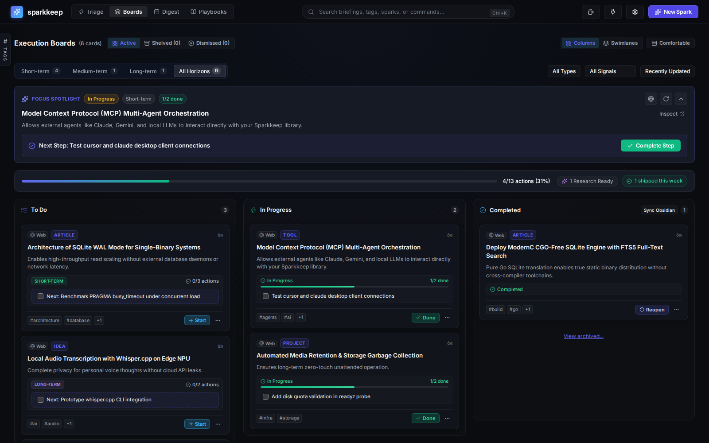
</p>

### 2. Execution Swimlanes & Docked Board Inspector
Switch between **Columns** and **Execution Swimlanes** grouped by Horizon or Card Type. Dragging a card between swimlane cells updates both its execution status and its Horizon in one motion. On widescreen displays, clicking a card opens a non-blocking **Board Inspector** docked to the right, so you can check off steps, edit the brief, and read research findings while the board stays live. Full keyboard parity: `j`/`k` to move, `Space` for the inspector, `o` for the full modal, `[`/`]` to change stage, `1`/`2`/`3` for Horizon.

<p align="center">
  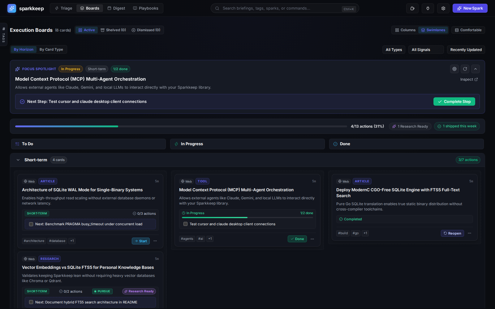
</p>

<p align="center">
  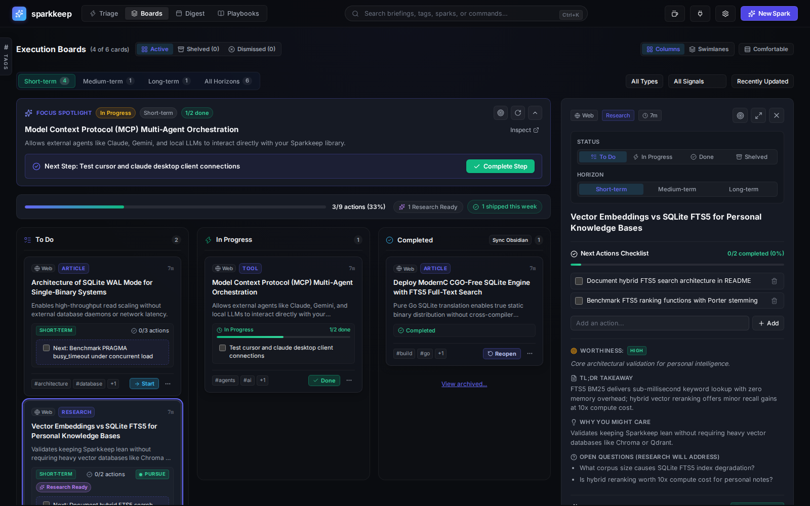
</p>

### 3. Swipeable Triage Deck
Burn through your incoming inbox backlogs with keyboard shortcuts (`1` Now, `2` Next, `3` Later, `Esc` Dismiss). Review instant AI synthesis, "Why You'd Care", and decomposed sub-actions before promoting to your active board.

<p align="center">
  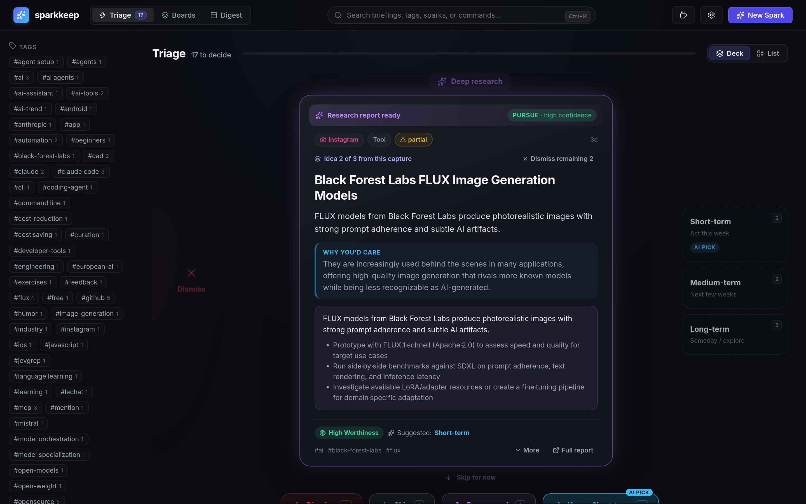
</p>

### 4. Structured Card Dossier, Action Checklist & Subject Cards
Every card decomposes captured sources into a concrete TL;DR takeaway, why it matters, an interactive checklist of next actions, and direct deep research triggers. User-authored notes are treated as first-class **Subject Cards** with on-demand AI triage synthesis and autonomous research grounding directly on your topic notes without requiring external URLs. Briefs can be regenerated non-destructively at any time.

<p align="center">
  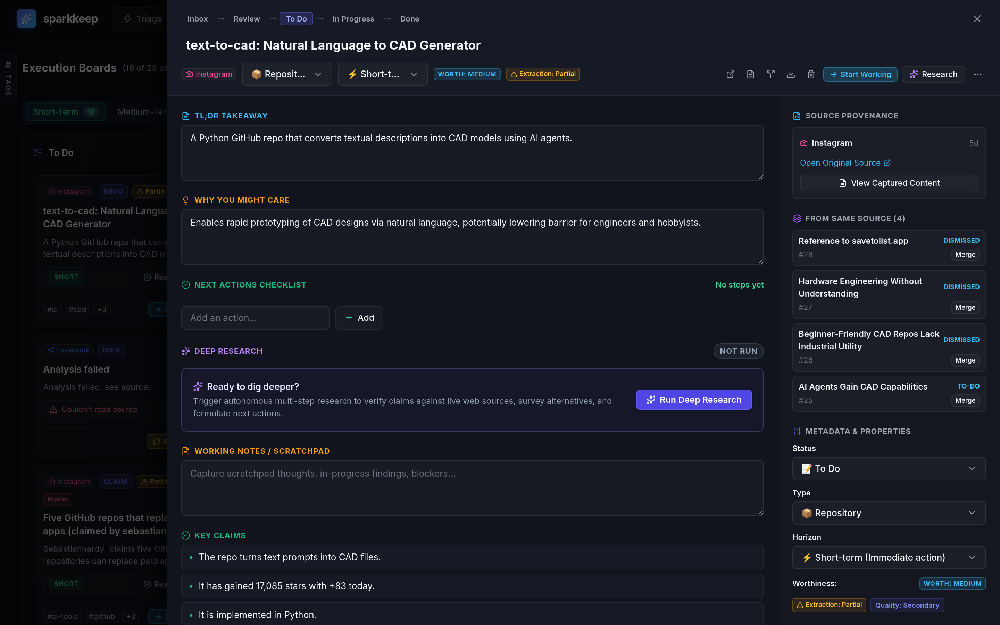
</p>

### 5. Deterministic Deep Research Dossier
Trigger autonomous, multi-step investigative playbooks that scrape the web, verify facts, assess risks, and issue an objective Pursue, Watch, or Skip verdict with high confidence scoring.

<p align="center">
  
</p>

### 6. Omnisearch (Cmd+K)
Instant, zero-latency full-text search powered by SQLite FTS5. Filter across card titles, summaries, tags, and research verdicts in milliseconds from anywhere in the app.

<p align="center">
  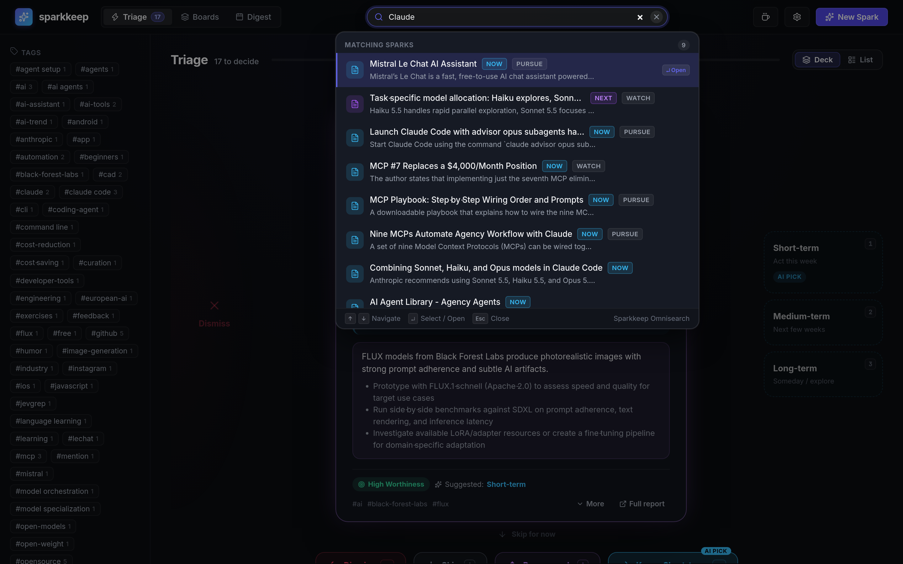
</p>

### 7. Intelligence Digest & Multi-Channel Broadcast
A full-screen review workspace with selectable **7-day**, **14-day**, and **30-day** windows. It combines a BYOK **Executive Retrospective**, a **Period Wins Showcase**, a **Period Momentum Pulse**, deep-research harvest, and interactive stale-bottleneck cleanup. Broadcast or export the brief to **Telegram**, **Discord**, **Slack**, or **OpenClaw** with one click, and open any card in the same docked Board Inspector used by the Execution Board.

<p align="center">
  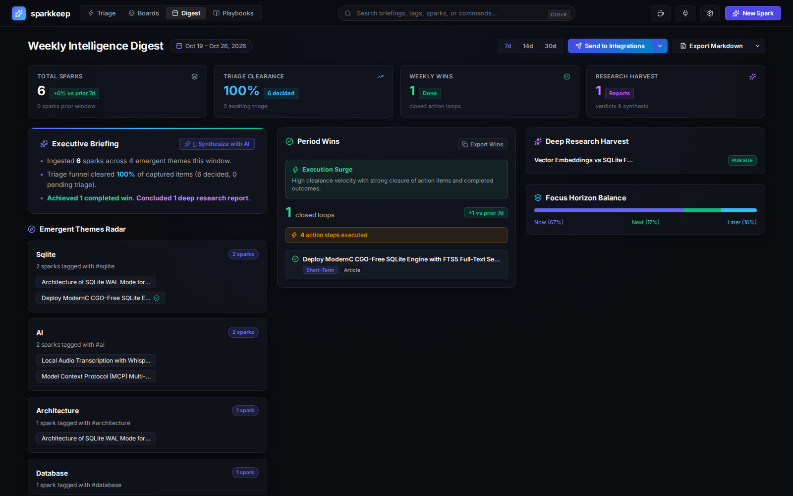
</p>

### 8. Playbook Studio Workspace & Pipeline Timeline
Design and customize deterministic research workflows in a dedicated, full-width builder canvas. Reorder pipeline steps via an interactive visual timeline, inspect real-time methodological rigor with the **5-Pillar Research Health Linter** (Grounding, Retrieval, Extraction, Verification, Delivery), apply 1-click auto-fix steps, and test prompts safely with zero-cost client-side dry runs and a cost estimator.

<p align="center">
  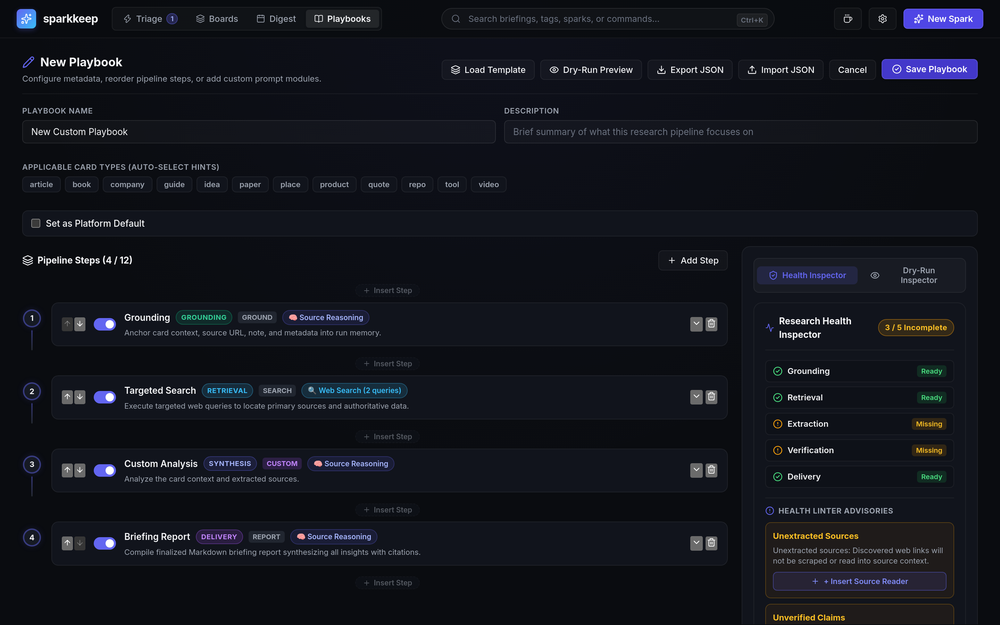
</p>

---

## ⚡ 1-Minute Quick Start

### Option 1: Docker (Recommended)

Run Sparkkeep instantly with zero configuration files:

```bash
docker run -d \
  --name sparkkeep \
  -p 8080:8080 \
  -v sparkkeep_data:/data \
  ghcr.io/burlacuandrei/sparkkeep:latest
```

### Option 2: Docker Compose

```yaml
services:
  sparkkeep:
    image: ghcr.io/burlacuandrei/sparkkeep:latest
    container_name: sparkkeep
    restart: unless-stopped
    ports:
      - "8080:8080"
    volumes:
      - ./data:/data
```

```bash
docker compose up -d
```

### Option 3: Pre-Built Standalone Binary

Download the latest lightweight (~24MB) binary for Linux, macOS, or Windows from [Releases](https://github.com/BurlacuAndrei/sparkkeep/releases):

```bash
# Example for Linux AMD64 (replace VERSION with the latest release, e.g. v0.9.2)
tar -xzf sparkkeep-<VERSION>-linux-amd64.tar.gz
./sparkkeep-linux-amd64
```

Then navigate to **`http://localhost:8080`** in your browser.

Prefer to look around first? The setup wizard offers a **one-click demo library** with representative cards, research dossiers, and playbooks. Demo data stays local and is stored in the same database as your own captures.

---

## 🧙‍♂️ Zero-Touch First-Run Wizard

No editing `.env` files or mounting secret volumes before booting. On initial launch, Sparkkeep walks you through an interactive setup directly in the UI:

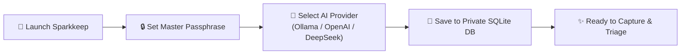

1. **Master Passphrase:** Secure your personal dashboard with bcrypt-backed session auth and an opaque HttpOnly session cookie.
2. **Bring Your Own Keys (BYOK):**
   - **Local & Private:** Ollama (`llama3.2`, `mistral`, `qwen2.5`), LM Studio, vLLM.
   - **Cloud Providers:** OpenAI (`gpt-4o-mini`, `gpt-4o`), DeepSeek (`deepseek-chat`, `deepseek-coder`), OpenRouter.
3. **Instant Launch:** Credentials save directly to your local SQLite database (`/data/sparkkeep.db`) with instant hot-reloading.
4. **Optional Demo Tour:** Seed a realistic demo library with one click, or skip it and start capturing immediately.

---

## 🚀 System Architecture

Sparkkeep is compiled into a **single, self-contained, CGO-free binary** with zero external database dependencies.

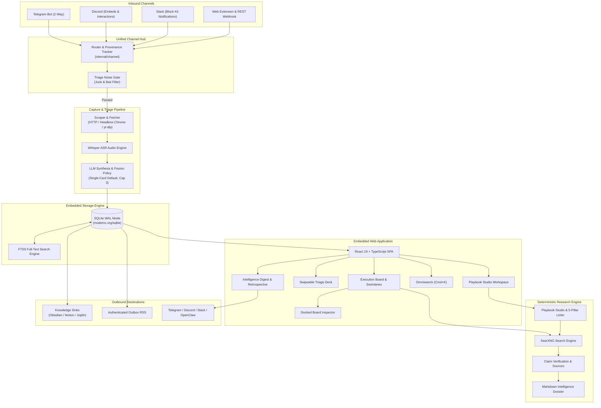

---

## ✨ Key Strengths & Capabilities

| Capability | What It Does | Why It Matters |
|---|---|---|
| **Zero-DB Single Binary** | Pure Go SQLite (`modernc.org/sqlite`), no CGO, no PostgreSQL, no Redis. | Runs anywhere (Raspberry Pi, NAS, VPS, Mac) in <30MB RAM with zero maintenance. |
| **Omni-Channel Capture** | Ingest links, notes, images, and voice memos from Telegram, Discord, Web Extension, and Webhooks; broadcast to Slack. | Never lose an idea on mobile or desktop. Capture from the apps you already live in. |
| **Interactive In-Place Triage** | Telegram inline keyboards & Discord ActionRows let you triage (`→ Doing`, `→ Done`, `Shelve`) directly in chat. | Triage from your notifications without ever opening the web app. |
| **Triage Noise Gate & Fission Cap** | Ingestion noise gate rejects junk/bait; enforces single-card default with a 3-card max cap. | Prevents social media engagement bait and card explosion from cluttering your Inbox. |
| **First-Class Subject Cards** | Capture raw ideas without URLs; run on-demand AI triage synthesis and autonomous research. | Freely capture open-ended hypotheses and research them with zero friction. |
| **Playbook Studio Workspace** | Visual step sequencer, 5-Pillar Research Health Linter, prompt dry runs, and template gallery. | Full freedom to compose custom research workflows while guaranteeing methodological rigor. |
| **Configurable Card Taxonomy** | Up to 20 user-defined macro Card Types with category-based playbook routing, alias resolution, and safe cascading. | Organize domain knowledge your way without classification drift or dead playbooks. |
| **Execution Board Workspace** | Widescreen columns or 2D swimlanes, Focus Spotlight, Execution Pulse, inline action checklists, and a docked inspector. | Start work in seconds instead of facing a passive wall of cards. |
| **Intelligence Digest Workspace** | 7/14/30-day review canvas with Period Wins, Momentum Pulse, and a persistent BYOK Executive Retrospective. | Turn periodic review into an actionable ritual, not a read-only report. |
| **Knowledge Sink Exports** | One-way, idempotent exports to Obsidian, Notion, and Joplin, plus client intents and an authenticated RSS outbox. | Move finished work into the tools where your long-term notes already live. |
| **Dual-View Productivity** | Switch seamlessly between fluid Execution Boards and a swipeable **Triage Deck**. | Rapidly burn through capture backlogs with minimal cognitive friction. |
| **Deterministic Deep Research** | Bounded, multi-step investigative playbooks (Ground → Plan → Search → Fact-Check → Verdict). | No hallucinating infinite loops; generates verified reports backed by citations. |
| **Omnisearch (Cmd+K)** | Instant, keyboard-first full-text search indexed in real-time via SQLite FTS5. | Find any card, snippet, tag, or note across years of captured data in milliseconds. |
| **Operations Ready** | `/livez` and `/readyz` probes, zero-dependency `/metrics`, backup/restore CLI, and library export as JSON or ZIP. | Run it on a NAS or VPS with the observability and recovery path you expect. |
| **Privacy-First BYOK** | Connect local Ollama instances or custom OpenAI-compatible endpoints, with per-role model routing. | With local models, your thoughts, notes, and research stay on your private hardware. |

---

## 📡 Multi-Channel Hub & Mobile Ingestion

Sparkkeep features an extensible Channel Hub with native long-polling adapters plus a **Universal Inbound Webhook (iOS Shortcuts, Android Share Sheet, cURL, automation platforms)** for mobile capture:

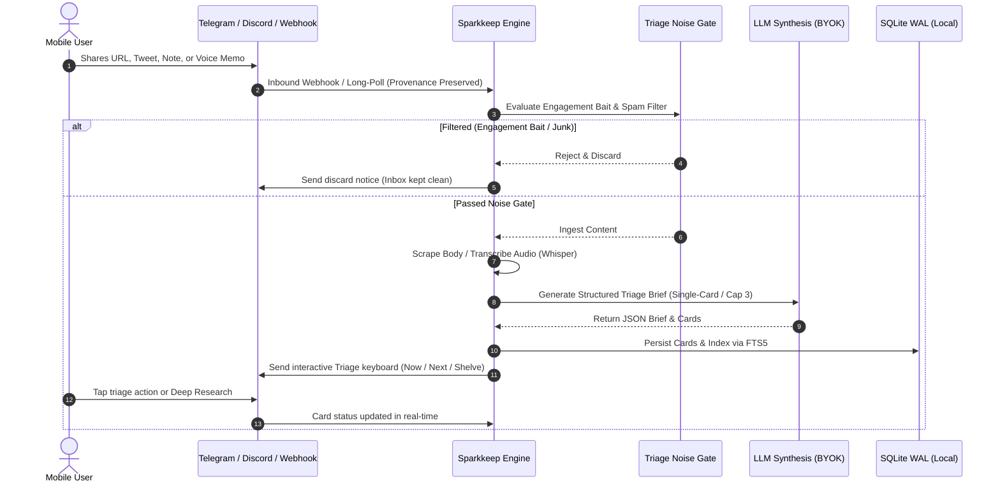

- **Telegram:** Built-in HTTP long-polling (`getUpdates`) with interactive inline keyboards (`→ Doing`, `→ Done`, `Research`, `Shelve`).
- **Discord:** Rich Embeds with action color bars and interactive ActionRow button components.
- **Slack:** Rich Block Kit formatting with header blocks, markdown sections, and interactive action buttons.
- **OpenClaw:** Optional gateway delivery to WhatsApp and other connected destinations.
- **Noise Gate Feedback:** Automatic discard notifications informing users when low-signal hype or spam has been filtered out.
- **Digest Broadcasts:** On-demand dispatches and scheduled automated summaries across connected channels, with selectable 7, 14, or 30-day windows.

---

## 🧠 Intelligence Digest & Executive Retrospective

The **Intelligence Digest** is a full-screen review workspace, not a static report. Pick a **7-day**, **14-day**, or **30-day** window and the title, comparison deltas, and telemetry adapt to that period.

- **Period Wins Showcase:** Celebrates cards closed in the window and counts executed action steps, even when the card was captured before the window started.
- **Period Momentum Pulse:** Classifies the period as Execution Surge, Research Deep-Dive, Balanced Flow, Discovery & Capture, or Quiet Horizon, with a plain-language explanation.
- **Executive Retrospective:** A dedicated `digest_synthesis` BYOK role writes a briefing, wins narrative, emergent themes, and up to three next-period focus cards. The prompt uses your User Profile and Output Language, and the result persists per window so it loads instantly on return.
- **Review to Action:** Start recommended cards with one click, inspect stale bottlenecks in the docked Board Inspector, or batch-shelve stale short-term work without leaving the digest.
- **Shareable Output:** Export Wins as Markdown, or send the digest to Telegram, Discord, Slack, or OpenClaw with the retrospective and wins included.
- **Offline Fallback:** With no LLM configured or an unreachable endpoint, a deterministic heuristic retrospective keeps the digest fully functional.

---

## 🔬 Deterministic Research Playbooks & Playbook Studio

Unbounded LLM loops are expensive and hallucinate. Sparkkeep combines deterministic, reproducible research playbooks with a visual authoring environment in **Playbook Studio**:

```
 [1. Ground]       Ingest card context, captured raw text, or Subject Card notes
      │
 [2. Plan]         Formulate decomposing questions and targeted search queries
      │
 [3. Search]       Execute queries against SearXNG or private search endpoints
      │
 [4. Read & Clip]  Fetch and clip candidate source URLs in parallel
      │
 [5. Fact-Check]   Cross-examine claims against extracted evidence with [S#] citations
      │
 [6. Landscape]    Evaluate competitive alternatives and industry positioning
      │
 [7. Verdict]      Synthesize Pursue / Skip / Watch recommendation with confidence score
      │
 [8. Dossier]      Compile comprehensive Markdown research dossier
```

### 5 Pillars of Research Health
The **Research Health Linter** guides users with non-blocking advisory checks and 1-click auto-fix steps as they compose playbooks:
1. **Grounding:** Anchors card context, provenance, and source metadata into the run.
2. **Retrieval:** Formulates targeted search queries and registers candidate source URLs.
3. **Extraction:** Scrapes and clips source content for evidence.
4. **Verification:** Cross-examines claims against extracted text with explicit `[S#]` citations.
5. **Delivery:** Produces an unequivocal Pursue, Watch, or Skip verdict, confidence score, and final Markdown dossier.

The Studio also shows a live **cost and resource estimator** for the configured pipeline, plus a client-side **Dry-Run Preview** that never calls a model.

### Category-Based Playbook Routing
Playbooks are routed deterministically based on card taxonomy:
`Explicit User Selection → Card Type Default → Platform Default`
This ensures books, code repositories, deep tech papers, and business tools automatically trigger the right analytical lenses without fragile tag maintenance.

---

## 📚 Knowledge Sinks & Outbound Integrations

Sparkkeep pushes finished work into the tools where long-term notes live. All sinks are **one-way and stateless**: exports are idempotent, and there is no two-way sync or conflict resolution to maintain.

- **Obsidian:** Export to a mounted vault directory with YAML frontmatter, the full card brief, checklist, and completed research dossier. Re-exporting updates the existing note instead of creating duplicates.
- **Notion:** Connect an internal integration token and database ID. Missing database properties are provisioned automatically, and pages update in place on re-export.
- **Joplin:** Push to a self-hosted Joplin Server or the Joplin Desktop Clipper API, using deterministic note IDs and a dedicated **Sparkkeep** notebook.
- **Automatic Triggers:** Configure per-sink auto-export for cards promoted to `doing`/`done` or after a research playbook completes.
- **Client Intents:** Open cards directly in Obsidian, Logseq, Things 3, Todoist, or GitHub without server-side setup.
- **Outbox RSS:** Subscribe to an authenticated, filterable RSS 2.0 feed of your cards and dossiers in FreshRSS, Miniflux, n8n, or Readwise Reader. Regenerate the feed token in **Settings → Integrations**.
- **Portable Export:** Download the whole library as JSON or a Markdown ZIP from Settings, and use `sparkkeep backup` for database snapshots.

---

## ⚙️ Configuration Reference

While all settings can be adjusted on the fly in the **Settings Modal**, you can pre-seed configurations via environment variables:

| Environment Variable | Default | Purpose |
|---|---|---|
| `SPARKKEEP_DB` | `./sparkkeep.db` (`/data/sparkkeep.db` in the container) | SQLite database file path |
| `SPARKKEEP_HTTP_ADDR` | `:8080` | Bind address and port |
| `SPARKKEEP_PUBLIC_URL` | `http://localhost:8080` | Public URL used in research report links |
| `SPARKKEEP_AUTH_TOKEN` | *(Dynamic DB)* | Master authentication bearer token |
| `SPARKKEEP_LLM_BASE` | `http://localhost:11434/v1` | OpenAI-compatible base URL |
| `SPARKKEEP_LLM_KEY` | *(Dynamic DB)* | API Key for LLM provider (optional for Ollama) |
| `SPARKKEEP_LLM_MODEL` | *(Dynamic DB)* | Model identifier (`llama3.2`, `gpt-4o`, `deepseek-chat`) |
| `SPARKKEEP_VISION_MODEL` | *(`SPARKKEEP_LLM_MODEL`)* | Vision model for image analysis |
| `SPARKKEEP_MAX_ANALYZE_TOKENS` | `2048` | Max tokens for a single LLM analysis |
| `SPARKKEEP_SEARCH_URL` | `https://searx.be` | SearXNG instance for deep research |
| `SPARKKEEP_HEADLESS_ENABLED` | `true` | Headless Chromium rendering toggle |
| `SPARKKEEP_CHROME_BIN` | *(auto-detect)* | Chromium/Chrome binary path |
| `SPARKKEEP_YTDLP` | `yt-dlp` | yt-dlp binary path |
| `SPARKKEEP_FFMPEG_BIN` | *(auto-detect)* | ffmpeg binary path |
| `SPARKKEEP_COOKIES_FILE` | `""` | Netscape cookies file for authenticated scraping |
| `SPARKKEEP_UPLOAD_DIR` | `<dbdir>/uploads` | Uploaded media directory |
| `SPARKKEEP_MAX_UPLOAD_MB` | `25` | Max size of a single upload (MB) |
| `SPARKKEEP_UPLOAD_MAX_SIZE_MB` | `0` | Post-transcode upload size limit (MB, 0 = disabled) |
| `SPARKKEEP_UPLOAD_MAX_AGE_DAYS` | `0` | Delete uploads older than N days (0 = disabled) |
| `SPARKKEEP_ASR_URL` | `""` | Whisper ASR endpoint |
| `SPARKKEEP_ASR_MODEL` | `""` | Whisper model name |
| `SPARKKEEP_TRANSCRIPT_LANGS` | `en.*,en` | Preferred transcript languages |
| `SPARKKEEP_TG_TOKEN` | `""` | Telegram Bot API token |
| `SPARKKEEP_TG_CHAT_ID` | `0` | Authorized Telegram user/chat ID |
| `SPARKKEEP_OFFSET_FILE` | `<dbdir>/bot_offset.json` | Telegram long-poll offset file |
| `SPARKKEEP_DIGEST_PUSH_ENABLED` | `true` when `SPARKKEEP_TG_TOKEN` is set | Digest push toggle |
| `SPARKKEEP_DIGEST_PUSH_DAY` | `0` | Digest day (0=Sunday .. 6=Saturday) |
| `SPARKKEEP_DIGEST_PUSH_HOUR` | `19` | Digest hour, local time (0..23) |
| `SPARKKEEP_DISCORD_TOKEN` | `""` | Discord bot token |
| `SPARKKEEP_DISCORD_CHANNEL_ID` | `""` | Discord channel/thread ID |
| `SPARKKEEP_DISCORD_PUBLIC_KEY` | `""` | Discord interaction public key |
| `SPARKKEEP_SLACK_WEBHOOK_URL` | `""` | Slack incoming webhook URL |
| `SPARKKEEP_SLACK_BOT_TOKEN`| `""` | Slack bot token |
| `SPARKKEEP_SLACK_CHANNEL_ID` | `""` | Slack channel ID |
| `SPARKKEEP_OPENCLAW_URL` | `http://localhost:18789` | OpenClaw gateway base URL |
| `SPARKKEEP_OPENCLAW_TOKEN` | `""` | OpenClaw gateway token |
| `SPARKKEEP_OPENCLAW_CHANNEL` | `whatsapp` | OpenClaw target channel |
| `SPARKKEEP_OPENCLAW_TARGET` | `""` | OpenClaw destination/recipient |

### 📈 Health & Observability

- `GET /livez` reports process liveness.
- `GET /readyz` checks database reachability and upload-directory write access.
- `GET /metrics` exposes a zero-dependency Prometheus text endpoint, including uptime and pipeline counters.

All three endpoints are unauthenticated by design so container orchestrators and reverse proxies can probe them.

### 💾 Backup & Restore

`sparkkeep backup [output-file]` writes a consistent single-file snapshot of the SQLite database using `VACUUM INTO`, safe to run while the daemon is live (WAL mode). Without an argument it writes `<dbdir>/backups/sparkkeep-<UTC YYYYMMDD-HHMMSS>.db`.

Restore with the CLI instead of copying files by hand:

1. Stop the daemon.
2. Run `sparkkeep restore <backup-file>`.
3. Start the daemon again.

The restore command verifies the backup integrity first, writes a timestamped `.pre-restore-*.bak` safety copy of the current database, replaces the database atomically, and runs a post-restore integrity check.

Both commands snapshot the SQLite database only. Uploaded media lives in `SPARKKEEP_UPLOAD_DIR` (default `<dbdir>/uploads`), a separate directory to copy alongside the backup. To export only your cards and research as portable files, use the JSON or Markdown ZIP export in **Settings → Integrations**.

---

## 🧩 Browser Extension (Chrome & Firefox)

Capture web pages, articles, and research sources with 1-click directly into your Sparkkeep library:
1. In Chrome/Brave/Edge, navigate to `chrome://extensions/` and enable **Developer mode**.
2. Click **Load unpacked** and select the [`extension/`](extension/) directory from this repository.
3. Click the Sparkkeep extension icon in your toolbar, enter your instance URL (e.g. `http://localhost:8080`) and your Master Passphrase / Token to connect.

---

## 🔄 Upgrade & Rollback Procedures

Sparkkeep uses forward-only SQLite migrations. When upgrading your instance:
1. **Take a backup:** Always create a backup before upgrading container images or binaries:
   ```bash
   # Docker
   docker compose exec sparkkeep sparkkeep backup /data/backup-pre-upgrade.db
   # Standalone binary
   ./sparkkeep backup ./backup-pre-upgrade.db
   ```
2. **Upgrade image or binary:** Pull the latest container (`docker compose pull && docker compose up -d`) or replace the executable. Schema migrations apply automatically on boot.
3. **Rollback:** Because schema downgrade protection prohibits older binaries from executing against newer schemas, rolling back requires stopping the daemon and running `sparkkeep restore <backup-file>` against your pre-upgrade snapshot.

## 🏛️ Technology Stack

- **Backend:** Go 1.26 (Standard library HTTP routing, pure-Go SQLite via `modernc.org/sqlite`, zero CGO).
- **Frontend:** React 19 + TypeScript + Vite. Assets are embedded directly into the Go executable via `//go:embed`.
- **Search:** Embedded SQLite FTS5 with database triggers for zero-lag full-text indexing.
- **Portability:** Builds into a single lightweight binary (<25MB) across Linux, macOS, and Windows.

---

## 🌐 Localization

The UI offers six interface languages: **English** (default), **Romanian**, **Spanish**, **Portuguese (Brasil)**, **French**, and **German**. All six have complete catalogs, each with the plural forms its language needs. Users switch language in **Settings → Appearance**; the choice persists in `localStorage` under `sparkkeep_locale`. `<html lang>` follows the active locale.

On first run the browser language picks the locale: an exact match first (so `pt-BR` resolves to Portuguese (Brasil)), then the base language (`es-419` → `es`, `de-AT` → `de`, `fr-CA` → `fr`, `pt` → `pt-BR`), else English. A browser language with no registered catalog renders English through the resolver fallback.

The frontend uses a small typed catalog module in [`frontend/src/i18n/`](frontend/src/i18n/): `en.ts` is the source of truth and `ro.ts`, `es.ts`, `pt-BR.ts`, `fr.ts`, and `de.ts` hold the translations. `index.tsx` exposes `LocaleProvider`, `useLocale()` (`t`, `tp`, `formatNumber`, `formatDate`), and the formatting helpers.

The selected interface locale is persisted server-side and also drives the **Output Language** for triage briefs, research dossiers, and digest retrospectives. Canonical card types resolve localized aliases, so an existing taxonomy keeps routing to the right playbook even when the UI language changes.

To add a locale:

1. Create `frontend/src/i18n/<code>.ts` exporting a `satisfies Catalog` object with the same shape as `en.ts`. TypeScript rejects missing or extra keys at compile time.
2. Add the code to the `Locale` union in `frontend/src/i18n/types.ts`.
3. Register the catalog in the `catalogs` map in `frontend/src/i18n/index.tsx`, and add a `locales` option (code plus native-language label). Check that detection maps the new code in `BASE_LANGUAGE` when it has no exact browser match.
4. Add the locale's plural rules to `pluralCategory` in `frontend/src/i18n/translate.ts` and cover them in `plural.test.ts`. Parity, coverage, and placeholder tests iterate every registered catalog, so they need no edits.
5. Run `cd frontend && npm test` and `npm run build`; commit the rebuilt `internal/web/dist`.

Persisted playbook seed data and third-party UI labels stay in English by design (see the `shortcut:` comments where relevant). Card copy is persisted in the locale that was active when it was written.

---

## ☕ Support Sparkkeep

Sparkkeep is 100% free and open-source software under the [AGPL-3.0 License](LICENSE). If Sparkkeep brings clarity to your thoughts, saves you time, or powers your daily workflow, consider buying a coffee or becoming a sponsor:

- ☕ **[Buy me a coffee on Ko-fi](https://ko-fi.com/andreiburlacu)** (0% platform fee, one-off tips or monthly)
- 💖 **[Sponsor on GitHub](https://github.com/sponsors/BurlacuAndrei)** (Direct GitHub sponsorship)

Your support fuels active maintenance, continuous feature development, and keeps Sparkkeep independent!

---

## 🤝 Contributing

We welcome community contributions, bug reports, and suggestions!
- Read our [Contributing Guide](CONTRIBUTING.md) to set up your local development environment.
- Review our [Security Policy](SECURITY.md) for vulnerability reporting.

---

## 📄 License & Transparency

Sparkkeep is open-source software licensed under the [AGPL-3.0 License](LICENSE). It is free to self-host and use internally; a commercial license is available where AGPL obligations cannot be met.

All features are included: capture, multi-channel messaging, triage, LLM analysis, the Execution Board, intelligence digests, research playbooks, one-way Knowledge Sink exports (Obsidian, Notion, Joplin), and webhooks are 100% free and open-source. There are no paid feature tiers, no license keys, and no gated capabilities. A commercial license is available for closed-source or SaaS distribution; [open an issue](https://github.com/BurlacuAndrei/sparkkeep/issues) for terms. For our architectural review, please refer to our internal [System Architecture](docs/design.md).