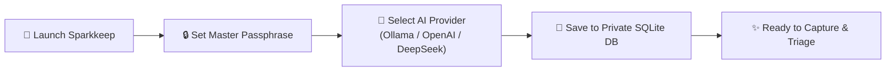
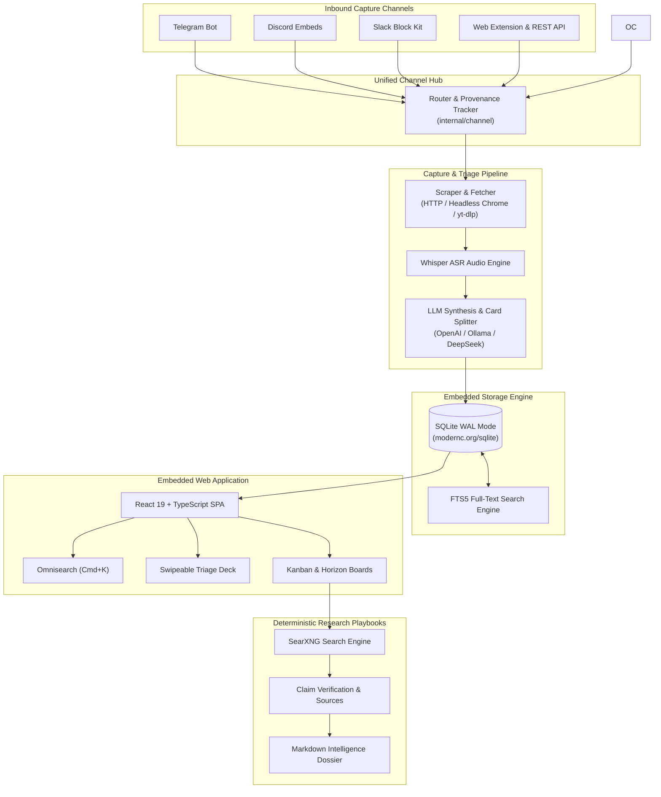
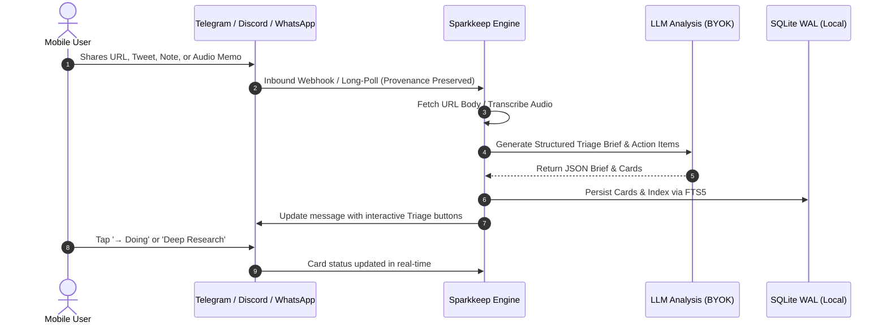

# Sparkkeep — Self-Hosted Capture & Action Engine

<p align="center">
  <b>Turn fleeting thoughts, links, and media into prioritized, actionable execution cards.</b>
  <br />
  <i>Packaged as a lightning-fast single binary with zero external database dependencies.</i>
</p>

<p align="center">
  <a href="https://github.com/BurlacuAndrei/sparkkeep/actions/workflows/ci.yml"></a>
  <a href="https://github.com/BurlacuAndrei/sparkkeep/actions/workflows/docker.yml"></a>
  <a href="LICENSE"></a>
  <a href="go.mod"></a>
  <a href="https://github.com/BurlacuAndrei/sparkkeep/releases"></a>
  <a href="https://hub.docker.com/"></a>
  <a href="https://ko-fi.com/andreiburlacu"></a>
  <a href="https://github.com/sponsors/BurlacuAndrei"></a>
</p>

---

## 💡 Why Sparkkeep?

Most "read-it-later" and bookmarking apps are digital graveyards: you save interesting links, repos, and notes, but **never execute on them**. 

**Sparkkeep is not a bookmark manager — it is an Action Engine.**

When you share an idea, tweet, GitHub repository, audio memo, or screenshot from your mobile phone or web browser, Sparkkeep:
1. **Captures it immutably** with full source provenance tracking.
2. **Scrapes & transcribes** content automatically (headless Chrome, yt-dlp, Whisper ASR).
3. **Synthesizes a structured Triage Brief** using your choice of LLM (local Ollama or cloud BYOK).
4. **Decomposes complex items** into discrete, actionable cards routed to realistic horizons (**Now**, **Next**, **Later**).
5. **Enables deep, hallucination-free research playbooks** with factual web groundings and citations.

```
 Traditional Bookmarkers:  Save Link ─────────────► Digital Graveyard 💀
 Sparkkeep Engine:         Capture ──► AI Triage ──► Horizon Routing ──► Deep Research ──► Shipped 🚀
```

---

## 🖥️ Platform Showcase

Every view in Sparkkeep is crafted for keyboard speed, minimal cognitive load, and frictionless execution.

### 1. Fluid Kanban & Horizon Boards
Organize triage cards across **Now**, **Next**, **Later**, and **Shelved** horizons with real-time drag-and-drop, automated tag indexing, and live progress indicators.

<p align="center">
  
</p>

### 2. Swipeable Triage Deck
Burn through your incoming inbox backlogs with keyboard shortcuts (`1` Now, `2` Next, `3` Later, `Esc` Dismiss). Review instant AI synthesis, "Why You'd Care", and decomposed sub-actions before promoting to your active board.

<p align="center">
  
</p>

### 3. Structured Card Dossier & Action Checklist
Every card decomposes the captured source into a concrete TL;DR takeaway, why it matters, an interactive checklist of next actions, full source provenance, and direct deep research triggers.

<p align="center">
  
</p>

### 4. Deterministic Deep Research Dossier
Trigger autonomous, multi-step investigative playbooks that scrape the web, verify facts, assess risks, and issue an objective Pursue, Watch, or Skip verdict with high confidence scoring.

<p align="center">
  
</p>

### 5. Omnisearch (Cmd+K)
Instant, zero-latency full-text search powered by SQLite FTS5. Filter across card titles, summaries, tags, and research verdicts in milliseconds from anywhere in the app.

<p align="center">
  
</p>

### 6. Weekly Intelligence Digest
Automated high-level syntheses identifying emergent themes across your captured cards, weekly win velocity, triage clearance rates, and horizon distribution balances.

<p align="center">
  
</p>

---

## ⚡ 1-Minute Quick Start

### Option 1: Docker (Recommended)

Run Sparkkeep instantly with zero configuration files:

```bash
docker run -d \
  --name sparkkeep \
  -p 8080:8080 \
  -v sparkkeep_data:/data \
  ghcr.io/burlacuandrei/sparkkeep:latest
```

### Option 2: Docker Compose

```yaml
services:
  sparkkeep:
    image: ghcr.io/burlacuandrei/sparkkeep:latest
    container_name: sparkkeep
    restart: unless-stopped
    ports:
      - "8080:8080"
    volumes:
      - ./data:/data
```

```bash
docker compose up -d
```

### Option 3: Pre-Built Standalone Binary

Download the latest lightweight (~24MB) binary for Linux, macOS, or Windows from [Releases](https://github.com/BurlacuAndrei/sparkkeep/releases):

```bash
# Example for Linux AMD64
tar -xzf sparkkeep-v1.0.0-linux-amd64.tar.gz
./sparkkeep-linux-amd64
```

Then navigate to **`http://localhost:8080`** in your browser.

---

## 🧙‍♂️ Zero-Touch First-Run Wizard

No editing `.env` files or mounting secret volumes before booting. On initial launch, Sparkkeep walks you through an interactive setup directly in the UI:



1. **Master Passphrase:** Secure your personal dashboard with bcrypt-backed session auth.
2. **Bring Your Own Keys (BYOK):**
   - **Local & Private:** Ollama (`llama3.2`, `mistral`, `qwen2.5`), LM Studio, vLLM.
   - **Cloud Providers:** OpenAI (`gpt-4o-mini`, `gpt-4o`), DeepSeek (`deepseek-chat`, `deepseek-coder`), OpenRouter.
3. **Instant Launch:** Credentials save directly to your encrypted SQLite database (`/data/sparkkeep.db`) with instant hot-reloading.

---

## 🚀 System Architecture

Sparkkeep is compiled into a **single, self-contained, CGO-free binary** with zero external database dependencies.



---

## ✨ Key Strengths & Capabilities

| Capability | What It Does | Why It Matters |
|---|---|---|
| **Zero-DB Single Binary** | Pure Go SQLite (`modernc.org/sqlite`), no CGO, no PostgreSQL, no Redis. | Runs anywhere (Raspberry Pi, NAS, VPS, Mac) in <30MB RAM with zero maintenance. |
| **Omni-Channel Capture** | Ingest links, notes, images, and voice memos from Telegram, Discord, and Slack. | Never lose an idea on mobile. Capture from the apps you already live in. |
| **Interactive In-Place Triage** | Telegram inline keyboards & Discord ActionRows let you triage (`→ Doing`, `→ Done`, `Shelve`) directly in chat. | Triage from your notifications without ever opening the web app. |
| **Dual-View Productivity** | Switch seamlessly between fluid Kanban Boards and a Tinder-style swipeable **Triage Deck**. | Rapidly burn through capture backlogs with zero cognitive friction. |
| **Deterministic Deep Research** | Bounded, multi-step investigative playbooks (Ground → Plan → Search → Fact-Check → Verdict). | No hallucinating infinite loops; generates verified reports backed by citations. |
| **Omnisearch (Cmd+K)** | Instant, keyboard-first full-text search indexed in real-time via SQLite FTS5. | Find any card, snippet, tag, or note across years of captured data in milliseconds. |
| **Privacy-First BYOK** | Connect local Ollama instances or custom OpenAI-compatible endpoints. | Your thoughts, notes, and research stay entirely on your private hardware. |

---

## 📡 Multi-Channel Hub & Mobile Ingestion

Sparkkeep features an extensible Channel Hub with native long-polling adapters and external gateway bridges:



- **Telegram:** Built-in HTTP long-polling (`getUpdates`) with interactive inline keyboards (`→ Doing`, `→ Done`, `Research`, `Shelve`).
- **Discord:** Rich Embeds with action color bars and interactive ActionRow button components.
- **Slack:** Rich Block Kit formatting with header blocks, markdown sections, and interactive action buttons.
- **Weekly Digest Broadcasts:** Automatic or on-demand digest broadcasts dispatched across all configured channels.

---

## 🔬 Deterministic Research Playbooks

Unbounded LLM loops are expensive and hallucinate. Sparkkeep's research engine executes deterministic, reproducible playbooks:

```
 [1. Ground]       Ingest card context, captured raw text, and metadata
      │
 [2. Plan]         Formulate decomposing questions and targeted search queries
      │
 [3. Search]       Execute queries against SearXNG or search endpoints
      │
 [4. Read & Clip]  Fetch and clip candidate source URLs in parallel
      │
 [5. Fact-Check]   Cross-examine claims against extracted evidence with [S#] citations
      │
 [6. Landscape]    Evaluate competitive alternatives and industry positioning
      │
 [7. Verdict]      Synthesize Pursue / Skip / Watch recommendation with confidence score
      │
 [8. Dossier]      Compile comprehensive Markdown research dossier
```

---

## ⚙️ Configuration Reference

While all settings can be adjusted on the fly in the **Settings Modal**, you can pre-seed configurations via environment variables:

| Environment Variable | Default | Purpose |
|---|---|---|
| `SPARKKEEP_DB` | `/data/sparkkeep.db` | SQLite database file path |
| `SPARKKEEP_HTTP_ADDR` | `:8080` | Bind address and port |
| `SPARKKEEP_AUTH_TOKEN` | *(Dynamic DB)* | Master authentication bearer token |
| `SPARKKEEP_LLM_BASE` | `http://localhost:11434/v1` | OpenAI-compatible base URL |
| `SPARKKEEP_LLM_KEY` | *(Dynamic DB)* | API Key for LLM provider (optional for Ollama) |
| `SPARKKEEP_LLM_MODEL` | *(Dynamic DB)* | Model identifier (`llama3.2`, `gpt-4o`, `deepseek-chat`) |
| `SPARKKEEP_TG_TOKEN` | `""` | Telegram Bot API token |
| `SPARKKEEP_TG_CHAT_ID` | `0` | Authorized Telegram user/chat ID |
| `SPARKKEEP_OPENCLAW_URL` | `http://localhost:18789` | OpenClaw Gateway bridge endpoint |
| `SPARKKEEP_OPENCLAW_TOKEN`| `""` | Bearer token for OpenClaw Gateway |
| `SPARKKEEP_DISCORD_TOKEN` | `""` | Discord bot token |
| `SPARKKEEP_SLACK_BOT_TOKEN`| `""` | Slack bot token |
| `SPARKKEEP_SEARCH_URL` | `https://searx.be` | SearXNG instance for deep research |
| `SPARKKEEP_HEADLESS_ENABLED` | `true` | Headless Chromium rendering toggle |

---

## 🏛️ Technology Stack

- **Backend:** Go 1.26 (Standard library HTTP routing, pure-Go SQLite via `modernc.org/sqlite`, zero CGO).
- **Frontend:** React 19 + TypeScript + Vite. Assets are embedded directly into the Go executable via `//go:embed`.
- **Search:** Embedded SQLite FTS5 with database triggers for zero-lag full-text indexing.
- **Portability:** Builds into a single lightweight binary (<25MB) across Linux, macOS, and Windows.

---

## ☕ Support Sparkkeep

Sparkkeep is 100% free and open-source software under the [MIT License](LICENSE). If Sparkkeep brings clarity to your thoughts, saves you time, or powers your daily workflow, consider buying a coffee or becoming a sponsor:

- ☕ **[Buy me a coffee on Ko-fi](https://ko-fi.com/andreiburlacu)** (0% platform fee, one-off tips or monthly)
- 💖 **[Sponsor on GitHub](https://github.com/sponsors/BurlacuAndrei)** (Direct GitHub sponsorship)

Your support fuels active maintenance, continuous feature development, and keeps Sparkkeep independent!

---

## 🤝 Contributing

We welcome community contributions, bug reports, and suggestions!
- Read our [Contributing Guide](CONTRIBUTING.md) to set up your local development environment.
- Review our [Security Policy](SECURITY.md) for vulnerability reporting.

---

## 📄 License & Transparency

Sparkkeep is open-source software licensed under the [MIT License](LICENSE).

All core capture, multi-channel messaging, triage, LLM analysis, and kanban workflows are 100% free and open-source. For our architectural and licensing review, please refer to our internal [System Architecture](docs/design.md).